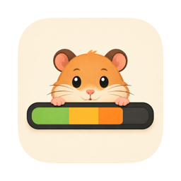

<p align="center">
  
</p>

<h1 align="center">cc-bar</h1>

<p align="center">
  <b>在 Mac 上管理 AI 编程工具、账号与用量</b><br>
  检查和更新应用，管理账号授权，在菜单栏查看额度，按对话与项目分析 Tokens 和费用。
</p>

<p align="center">
  <a href="https://github.com/FffPlum/cc-bar/releases/latest"></a>
  <a href="https://github.com/FffPlum/cc-bar/releases"></a>
  <a href="LICENSE"></a>
</p>

<p align="center">
  <a href="https://github.com/FffPlum/cc-bar/releases/latest">下载</a> ·
  <a href="#应用管理">应用管理</a> ·
  <a href="#账号授权与额度">账号与额度</a> ·
  <a href="#用量统计">用量统计</a> ·
  <a href="#数据与隐私">数据与隐私</a> ·
  <a href="#从源码构建">从源码构建</a> ·
  <a href="https://github.com/FffPlum/cc-bar/issues">问题反馈</a>
</p>

cc-bar 是常驻 macOS 菜单栏的 AI 工具管理与用量分析应用。主窗口集中展示已安装工具、账号、供应商和统计数据；菜单栏、展开面板与桌面悬浮窗用于随时查看额度和重置时间。

应用由 **Swift / AppKit / SwiftUI 原生宿主**与 **React / TypeScript 主窗口**组成。React 界面随安装包打包，在本地 WKWebView 中运行；凭据访问、网络请求、安装操作、日志扫描、计费与持久化由 Swift 通过统一 Host API 提供。

## 安装

- **系统**：macOS 14 Sonoma 或更新版本。
- **架构**：当前发布的安装包面向 Apple Silicon（arm64）。
- **运行**：安装包自带界面资源，无需安装 Node.js 或启动开发服务。

在 [最新发布页](https://github.com/FffPlum/cc-bar/releases/latest) 下载 `CCBar.dmg`，打开后将 `CCBar.app` 拖入「应用程序」；也可以下载 `CCBar.app.zip` 解压安装。后续可在「设置 → 通用」检查并安装更新。

当前发布包采用 ad-hoc 签名，未经过 Apple 公证。首次打开如被系统拦截，请在确认下载来源后，前往「系统设置 → 隐私与安全性」查看并允许打开。

启动后可先到「应用」查看安装情况，再到「额度管理」选择需要展示的账号。已有 Codex、Claude Code 等工具的登录通常可自动识别；需要读取系统钥匙串时，应用会说明用途并请求授权。Kimi Code 和 DeepSeek Harness 也支持下文所述的应用内授权入口。

## 应用管理

在一页中查看工具是否安装、当前版本和安装来源，检查更新，并在支持的来源上执行安装、升级或卸载。同一工具的多处安装分别识别，当前 PATH 中生效的 CLI 与其他安装分开展示。

| 类型 | 当前应用目录 |
| --- | --- |
| 命令行工具 | Claude Code、Codex CLI、Gemini CLI、Grok Build、OpenCode、OpenClaw、Hermes Agent、Pi、MiniMax Code、Kimi Code、DeepSeek Harness、Antigravity CLI、Oh My Pi、Command Code |
| 桌面应用 | Claude Desktop、Cursor、Antigravity、Codex Desktop |

- **安装与配置分开识别**：只发现配置目录时，不会直接判定应用已经安装；无法确认版本或管理来源时，明确显示未知或不可用原因。
- **按实际来源管理**：根据已识别的包管理器或官方安装来源提供操作；安装、升级、卸载前展示确认，完成后重新检测结果。
- **保留配置与历史**：卸载针对程序本身，桌面应用移入废纸篓。任务进度由原生宿主持有，切换页面或关闭主窗口后仍可继续查看。
- **独立选择展示内容**：为支持的应用选择是否加入侧栏、是否显示用量统计；这些选择不等于启用账号额度，也不会删除已有统计。

应用详情展示当前安装、登录身份和已识别的供应商连接。供应商目录可收纳已有或手动添加的 API Key，包括 OpenAI、Anthropic、Kimi / Moonshot、DeepSeek、Grok、Gemini 和自定义地址。添加供应商条目只保存到 CCBar；当前界面不提供替换外部工具配置或切换其供应商的操作。

**安装目录不等于额度或统计支持列表。** 不同工具能够提供的数据见下文。

## 账号授权与额度

订阅额度来自服务端，本机 Tokens 与费用来自日志分析，两者分别展示，不把本机估算当作官方账单。

| 服务 | 当前能力 |
| --- | --- |
| Codex / ChatGPT | 自动识别本机 Codex 登录；支持导入单个或多个 OAuth `auth.json` 账号，独立查看额度与重置时间，不切换 Codex CLI 登录 |
| Claude | 识别 Claude Code 与 Claude Desktop 的本机登录，按服务返回展示订阅额度、重置时间及模型专项额度 |
| Kimi Code | 识别 CLI 登录；支持国内 / 海外官方设备授权及多个独立订阅账号，不覆盖 CLI 登录 |
| Antigravity | 识别本机登录，查询官方 CLI / 云端返回的模型额度与重置时间 |
| Cursor | 保留 Total / Auto / API 额度及远端计量支持；不限量状态单独展示，数据按 Cursor 账号统计 |
| DeepSeek Harness | 识别 DSH 登录，或通过系统浏览器完成官方账号授权；展示钱包余额、充值与赠金，不换算成订阅百分比 |
| Grok / xAI | 识别本机登录身份与状态，暂未接入额度查询 |

「额度管理」按 Claude、ChatGPT、Kimi Code、xAI、DeepSeek Harness、Antigravity 六组组织账号。每个可展示账号分别选择「菜单栏 / 悬浮窗」；悬浮窗选项同时控制菜单栏展开面板，桌面窗口另有总开关。关闭两个展示位置后停止该账号的自动额度刷新，保留凭据与历史。

API Key 在应用的供应商目录管理，与 OAuth / 官方账号授权分开。Moonshot、Command Code、OpenCode Go 等 API Key 当前不用于自动余额或额度查询；Cursor 保留已有额度与统计能力，但不列入上述六组管理页。

菜单栏可显示主要额度、周额度或两者；展开面板补充详情，桌面悬浮窗支持拖动、位置记忆与边缘吸附。额度不足时可发送系统通知。后台刷新在睡眠时暂停，锁屏时降频；网络失败保留已有快照，手动刷新同样遵守服务限流后的退避。

## 用量统计

| 视图 | 可以查看的内容 |
| --- | --- |
| 概览 | Tokens、请求数、费用、缓存命中率与趋势；按应用、来源和模型筛选，查看历史活跃情况 |
| 对话 | 检索会话，查看输入 / 输出 / 缓存明细、模型构成与费用；日志有可靠计时时显示首字延迟和输出速度 |
| 项目 | 汇总项目用量、趋势、高消耗对话与分支分布；识别 Git worktree 与主仓库的关系 |
| 额度 | 对比官方额度与可归属的本机周期消耗，查看当前额度、用满估算与每日额度趋势；不同账号、周期和额度窗口分别计算 |

**本地日志来源**：Codex、Claude Code、Antigravity、Pi、OpenCode、DeepSeek Harness（DSH）、Kimi Code。**远端计量来源**：Cursor，覆盖该账号的多设备用量，不代表只在这台 Mac 上发生的活动。

- **切换图表样式**：在显示设置中选择柱状图或曲线面积图。Tokens、请求数与费用的柱图按应用堆叠，面积图按应用独立绘制；缓存命中率展示各应用真实比率，全部应用的柱图并排比较，提示同时保留总体加权比率。
- **控制自动扫描**：用量设置抽屉提供自动扫描开关、1 / 2 / 3 / 5 / 10 分钟周期和「立刻同步」。默认开启、每 5 分钟扫描；关闭后保留历史，仍可手动同步或重新计算，已开始的扫描会完成。此开关不停止订阅额度或 Cursor 远端计量刷新。
- **保留历史、更新估算**：价格或统计规则变化后可重新计算；源日志已清理的历史记录尽量保留。部分模型没有可靠价格、日志字段缺失或远端数据未覆盖时，会保留相应的不完整状态。

本机费用按日志和模型价格估算，可能与订阅扣量、折扣或实际账单不同。跨工具的 Codex 订阅用量可按设置合并到周期统计；没有可靠账号归属的数据不会复制成多个账号各自的用量。

## 数据与隐私

- **统计保存在本机**：会话日志、外部应用数据库按只读方式解析，汇总与可重建索引保存在 CCBar 的 Application Support 目录。统计包含会话标题、模型、项目路径、分支和标识等元数据；标题缺失时可能从用户消息中提取摘要，不应将本地统计文件视为已匿名化数据。
- **网络访问有明确用途**：账号授权与续期、额度和 Cursor 计量查询、价格与服务状态、应用版本检查和下载、CCBar 更新会联网。本机会话日志和项目内容不上传用于统计；诊断日志也不自动上报。
- **凭据不都存于钥匙串**：原工具的登录按各服务规则读取，部分 OAuth 续期会更新其原登录文件。CCBar 托管的账号凭据、API Key 及验证后的部分应用解密密钥保存在本机私有文件中，目录权限为 `0700`、凭据文件为 `0600`；旧钥匙串凭据在成功读取后迁移。这是文件权限保护，同一 macOS 用户下的其他进程仍可能读取。
- **界面与原生能力分开**：React 通过有类型和运行时校验的 Host API 请求数据及操作，不获得任意文件读取或命令执行接口。凭据原文只用于明确的保存输入，不出现在返回快照、事件、错误或日志中。
- **隐私模式用于展示**：开启后隐藏界面中的账号身份、会话标题、项目路径等敏感信息，不改写本机原始记录。导出或分享内容前仍应检查。

排查问题时，可从「设置 → 通用」导出诊断日志，检查内容后自行附到 [Issue](https://github.com/FffPlum/cc-bar/issues)。应用不自动发送诊断包、行为遥测或崩溃报告。

## 从源码构建

需要 **Xcode 26 或更新版本（Swift 6.2+）**、**Node.js 22.12 或更新的兼容版本**及 npm。只有 Command Line Tools 不足以完成应用构建。

```bash
git clone https://github.com/FffPlum/cc-bar.git
cd cc-bar

# 一次性选择完整 Xcode
sudo xcode-select -s /Applications/Xcode.app/Contents/Developer

# 首次构建或前端 lockfile 变化后，安装锁定依赖并构建主窗口资源
./scripts/build-web-interface.sh --install
```

之后在 Xcode 打开 `ccbar.xcodeproj`，选择 `ccbar` Scheme 与「My Mac」，运行即可。也可以仅做 Debug 构建：

```bash
xcodebuild -project ccbar.xcodeproj -scheme ccbar -configuration Debug -destination 'platform=macOS' build
```

后续 Xcode 构建会更新 React 资源，不会自动联网安装 npm 依赖。

### 打包

分发使用仓库脚本，不使用 Xcode Archive / Export 替代：

```bash
SPARKLE_PUBLIC_ED_KEY="你的 Ed25519 更新公钥" ./scripts/build.sh
```

脚本构建 Release、嵌入界面资源并完成签名，默认输出 `dist/CCBar.dmg` 和 `dist/CCBar.app.zip`。默认采用 ad-hoc 签名；本机自用可运行 `python3 scripts/setup-local-signing.py` 配置固定自签名身份。脚本默认使用工程构建架构，也可通过 `CCBAR_BUILD_ARCH=arm64` 或 `x86_64` 指定；仓库发布流程当前指定 `arm64`。

`SPARKLE_PUBLIC_ED_KEY` 是 Base64 编码的 32 字节 Ed25519 公钥，打包时必填。发布流程另需 repository secret `SPARKLE_PRIVATE_ED_KEY` 为更新包签名，私钥不能放入应用或提交到仓库。密钥配置、签名和发布步骤见 [打包发布](docs/打包发布.md)。

### 代码与文档

| 目录 | 内容 |
| --- | --- |
| `Sources/CCBar/` | 原生宿主、菜单栏与悬浮窗、账号、调度、扫描、计费和存储 |
| `Sources/CCBarConfiguration/` | 应用目录与可独立测试的配置核心 |
| `packages/interface/` | React / TypeScript 主窗口 |
| `packages/host-api/` | 前端使用的统一 Host API 类型、校验与客户端 |
| `Tests/` | Swift 测试 |
| `docs/` | 产品、布局、技术实现、接口和发布文档 |

开发入口见 [文档索引](docs/README.md)、[技术实现](docs/技术实现.md) 与 [React 主窗口接口契约](docs/React主窗口接口契约.md)。

## 参考与致谢

- [nanvon/cc-bar](https://github.com/nanvon/cc-bar)：本项目最初 fork 自该仓库，并在此基础上独立维护和演进。感谢原作者提供的原生菜单栏与用量监控基础。
- [CC Switch](https://github.com/farion1231/cc-switch)：应用目录、工具检测、版本检查与卸载行为的重要参考，也为配置交互提供了参考。
- [CodexBar](https://github.com/steipete/CodexBar)：额度监控、本地日志解析与原生菜单栏交互的参考。
- [cockpit-tools](https://github.com/jlcodes99/cockpit-tools)：多平台账号、额度与刷新机制的参考。

感谢 [LINUX DO](https://linux.do/) 社区的交流与反馈。本项目的下载、更新与问题反馈均以 [FffPlum/cc-bar](https://github.com/FffPlum/cc-bar) 为准。

## 许可证

本项目按 [MIT License](LICENSE) 开源，保留原项目的 `Copyright (c) 2026 nanvon` 及许可声明。使用、修改或分发时请一并保留相应版权与许可信息。
